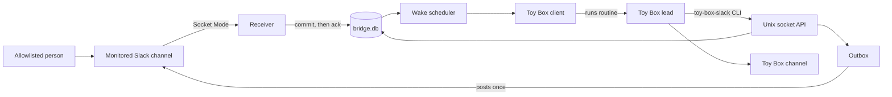

toy-box-slack is a local bridge built on the Bun runtime that lets a Toy Box channel's lead watch one Slack channel and answer it. It uses `@slack/socket-mode` and `@slack/web-api` to talk to Slack, Bun's SQLite driver for durable state, Toy Box's loopback HTTP API to wake the lead, citty for its CLI, and zod for every contract that crosses a process boundary.

## Architecture

The central unit is a link: one Toy Box channel bound to one Slack channel, with an allowlist of Slack people and its request and observation modes. Everything the bridge stores or does on Slack's behalf belongs to a link, and unlinking deletes what the link owned. The bridge forgets what people say in Slack and what it posts there 30 days after it last changed, unless the post may still go out. What it keeps longer about them has no text, only what posting once and numbering need.

The bridge is one long-running process per data folder and the only thing that talks to Slack. It hosts one or more apps, each a Slack app with its own bot, tokens, `bridge.db` and lock. The default app keeps them in the data folder itself, and an app `add-app` added keeps them in `apps/<name>`. One Slack app has one bot, and people tell leads apart by the bot they mention, so leads that share a Slack channel each link through an app of their own. Each app runs the pipeline below over its own `bridge.db`, and no two apps connect through the same Slack app. `src/features/bridge` composes every subsystem into that process and owns startup, each app's database connection and lock, the socket server, and the retention pass it runs at startup and hourly. Startup takes every app's lock and opens every `bridge.db` before any app talks to Slack. Each feature declares its tables in `server/schema.ts`, and the bridge creates them all together when `bridge.db` is new. Changing a table raises the schema version in `src/features/bridge/server/database.ts` and records the new version's tables in `src/features/bridge/server/schemas`, which starts with the version 0.1.0 shipped. Owners update by installing a release and restarting, so the bridge migrates a `bridge.db` that any recorded version made, and tests hold a new `bridge.db` and each migrated one to the current version's tables. The bridge refuses a `bridge.db` that any other version made. The bridge receives events over Socket Mode and commits each one to SQLite before acking it, so an acked event survives a crash or power loss. The ledger keeps one row per channel and `ts` and appends a change for every new, edited, or deleted message. Request classification runs in the same transaction, so a stored message and the request it opened or joined never disagree.

The bridge never posts into Toy Box. It reaches the lead only by running a routine the lead registered, which wakes the lead privately with the routine's prompt. The lead reaches Slack only through the `toy-box-slack` CLI, which calls the bridge over a Unix socket. The bridge runs each command in the app the caller's Toy Box channel links through, or in the default app when it links through none, and `link --app` names another for a channel that isn't linked yet. Link and resume run one at a time across every app, so a Toy Box channel links through at most one. Replies and publications are queued in an outbox that rechecks policy at send time, posts once with metadata naming the item, and reconciles any post whose outcome it can't confirm instead of retrying it.



toy-box-slack assumes one owner on one Mac, like Toy Box itself. Only people on a link's allowlist, identified by their exact Slack user ID and never by the workspace a message names, can make the lead act, and bridge code enforces that before the lead sees anything. Slack text is data: it reaches the lead fenced and labeled with its author, and only the owner widens access, from a terminal rather than a lead's shell. The data folder is 0700 and the socket 0600, tokens live only in the bridge, and the bridge talks only to a Toy Box on loopback and opens no listening port. Any process running as the owner is inside that boundary, and the design doesn't pretend otherwise. Each app's `bridge.db` survives restarts; the Socket Mode connections, the socket, and posts in flight do not, and startup recovers each of them before taking work.

The CLI ships on npm as one compiled Bun binary for Apple silicon Macs, built by `bun run build` and run through the `toy-box-slack` launcher beside it. Toy Box sets `BUN_BE_BUN` in every agent's shell, which turns a compiled Bun program into Bun itself, so the launcher clears it. The binary has no checkout to read from, so a file it ships, like the skill, is imported as text, and it ignores any `.env` or `bunfig.toml` in the folder it runs from.

### Subsystem guides

Each guide explains one capability end to end. Read them in order for a first architecture pass; for a targeted change, start with the guide whose responsibility matches it.

- [`src/features/activity/AGENTS.md`](src/features/activity/AGENTS.md): Socket Mode events committed into the message ledger, and the channel changes that suspend a link
- [`src/features/requests/AGENTS.md`](src/features/requests/AGENTS.md): the request loop, from classification and the request lifecycle to waking the lead and the CLI contract it answers through
- [`src/features/outbox/AGENTS.md`](src/features/outbox/AGENTS.md): every write to Slack, checked at send time, posted once, and reconciled when its outcome is unknown
- [`src/features/links/AGENTS.md`](src/features/links/AGENTS.md): link settings, the allowlist, the owner's setup commands, and suspensions
- [`src/features/toybox/AGENTS.md`](src/features/toybox/AGENTS.md): reading a Toy Box channel, and waking its lead by running one of its routines
- [`tests/AGENTS.md`](tests/AGENTS.md): the unit, integration, end-to-end, and live layers and the protocol fakes they share

## Writing Great Code

Great code pursues simplicity by placing a rich domain model at the center, decomposing it into clear responsibilities, and applying functional principles to express its behavior directly. Architecture, state, control flow, boundaries, and tests should follow from real requirements and preserve the product experience with as little machinery as possible.

- Domain coherence
  - Define the smallest coherent ontology of concepts and relationships, then use that vocabulary consistently across every subsystem and layer. These become the system's nouns; scrutinize every addition.
  - Express operations over those values as domain verbs (the subsystem's algebra). A subsystem's public surface should expose capabilities rather than incidental types, wrappers, or implementation steps.
  - Use that model to make valid states, transitions, true dependencies, expected side effects, and ownership explicit. Prefer one source of truth and representations that exclude invalid combinations when practical.
- Semantic decomposition
  - Decompose the domain into subsystems with independently nameable roles, ownership, and contracts. Each subsystem should expose a coherent capability rather than mirror implementation mechanics.
  - Within each subsystem, give every module and component one semantic responsibility. Create or extract one when it gives a capability a clear owner, removes real repetition, or clarifies composition; inline wrappers that only add indirection.
  - Grow the system by extension. Before building a capability, look for an existing one in the owning feature, shared modules and components, sibling features, the installed libraries, and the platform, and extend what fits instead of building a parallel version.
  - Within each file, optimize for linear top-to-bottom reading. Establish its role, domain concepts, and common control flow before supporting mechanics and edge cases; comment only to explain a non-obvious role or invariant.
- Functional architecture
  - Within each boundary, implement domain behavior as a pure, referentially transparent core over immutable values, with explicit inputs, outputs, and transitions.
  - Isolate unavoidable effects, including UI animation, persistence, timers, and external communication, at the owning component or module boundary, with explicit lifetimes and failure behavior.
  - Compose subsystems through narrow contracts. Keep policy and orchestration with their owning layer, and share only genuinely generic mechanics.
- Verifiable contracts
  - Encode domain invariants and policy in executable tests. Verify observable behavior, valid transitions, lifecycle outcomes, and boundary guarantees rather than private implementation details or duplicated logic.
  - Concentrate exhaustive coverage around foundational state machines, reducers, policies, codecs, and boundaries where one defect propagates widely. Test leaf consumers when they own distinct behavior, lifecycle, or integration risk.
  - Keep tests deterministic and readable as specifications: order common behavior before edge cases, prove one contract per test, and introduce narrow seams or protocol-faithful fakes only when needed.

## Definition of Done

- Run `bun run check` and fix any formatting, lint, or typecheck issues. The pre-commit hook runs the linter and formats staged files, and CI runs check, the tests and the build on every push and pull request.
- Run `bun test` and fix any failing tests. It runs the unit and integration suites with no network or credentials.
- Run the end-to-end suite when a change alters what a lead reads or runs, or how the bridge wakes it, and the live check when it changes how the bridge talks to Slack. CI runs neither, and [tests/AGENTS.md](tests/AGENTS.md) says how.
- Prove every failure a change handles with a test at the layer that can observe it: unit tests for policies, integration tests for anything that crosses Slack, Toy Box, the socket, or a process boundary.
- Update the owning guide when a change moves a responsibility or an invariant.

## Releasing

Only the Publish workflow publishes to npm. To release:

1. Update `package.json` to the next stable version, and add its release notes under a matching `## 📅 vX.Y.Z (date)` heading in `CHANGELOG.md`, saying what changed for owners and anything they must do besides updating. Commit and push.
1. Run the end-to-end suite and the live check on that commit, as [tests/AGENTS.md](tests/AGENTS.md) describes, since CI runs neither.
1. Select **Actions → Publish → Run workflow** on the branch.

The workflow reads the version and notes from that exact commit, rejects an already published npm version, runs checks and tests, and builds the Apple silicon macOS CLI. It publishes the tested package through npm trusted publishing, then creates the matching GitHub tag and release with the changelog notes and npm tarball attached. No npm token or separately entered release version is needed.

npm accepts that publish only from the package's trusted publisher, which is this repository's `publish.yml` and has published every release since 0.2.0. If the repository or the workflow's file name changes, a maintainer with 2FA sets a new one from a terminal signed in to npm, with `--allow-publish` since a new trusted publisher can only stage a publish by default. Then run the workflow within 2 days, since npm expires a new trusted publisher that hasn't published by then.

```sh
npm trust github @avanderhoorn/toy-box-slack --repo avanderhoorn/toy-box-connectors --file publish.yml --allow-publish
```

If a run fails before npm publication, fix the failure and rerun. If npm succeeds but GitHub release creation fails, recover the tarball from npm with `npm pack @avanderhoorn/toy-box-slack@X.Y.Z --ignore-scripts`, verify its registry integrity, and use that tarball and the original commit's changelog notes to finish the GitHub release manually. Do not rebuild or republish the same npm version.
