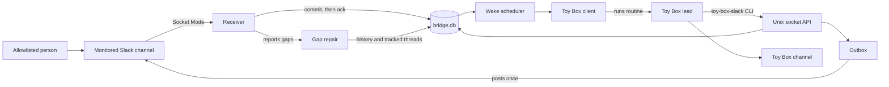

toy-box-slack is a local bridge built on the Bun runtime that lets a Toy Box channel's lead watch one Slack channel and answer it. It uses `@slack/socket-mode` and `@slack/web-api` to talk to Slack, Bun's SQLite driver for durable state, Toy Box's loopback HTTP API to wake the lead, citty for its CLI, and zod for every contract that crosses a process boundary.

## Architecture

The central unit is a link: one Toy Box channel bound to one Slack channel, with an owner, an allowlist of Slack people, request and observation modes, and the routines its lead registered. Everything the bridge stores or does on Slack's behalf belongs to a link, and unlinking purges what the link owned.

The bridge is one long-running process per data folder and the only thing that talks to Slack. `src/features/bridge` composes every subsystem into that process and owns startup, the database connection, the single-bridge lock, and the socket server. The bridge receives events over Socket Mode and commits each one to SQLite before acking it, so an acked event survives a crash or power loss. The ledger keeps one row per channel and `ts` and appends a change for every new, edited, or deleted message. Request classification runs in the same transaction, so a stored message and the request it opened or joined never disagree. After a disconnect or a rate limit, gap repair reads history across the gap with overlap and merges what it finds exactly like live events.

The bridge never posts into Toy Box. It reaches the lead only by running a routine the lead registered, which wakes the lead privately with the routine's prompt. The lead reaches Slack only through the `toy-box-slack` CLI, which calls the bridge over a Unix socket. Replies and publications are queued in an outbox that rechecks policy at send time, posts once with metadata naming the item, and reconciles any post whose outcome it can't confirm instead of retrying it.

toy-box-slack assumes one owner on one Mac, like Toy Box itself. Only people on a link's allowlist, identified by Slack team and user, can make the lead act, and bridge code enforces that before the lead sees anything. Slack text is data: it reaches the lead fenced and labeled with its author, and settings change only through audited setup commands. The data folder is 0700 and the socket 0600, tokens live only in the bridge, and the bridge talks only to a Toy Box on loopback and opens no listening port. Any process running as the owner is inside that boundary, and the design doesn't pretend otherwise. `bridge.db` survives restarts; the Socket Mode connection, the socket, and posts in flight do not, and startup recovers each of them before taking work.

### Subsystem guides

Each guide explains one capability end to end. Read them in order for a first architecture pass; for a targeted change, start with the guide whose responsibility matches it.

- [`src/features/activity/AGENTS.md`](src/features/activity/AGENTS.md): Socket Mode events committed into the message ledger, tracked threads, coverage, and gap repair
- [`src/features/requests/AGENTS.md`](src/features/requests/AGENTS.md): the request loop, from classification and the request lifecycle to waking the lead and the CLI contract it answers through
- [`src/features/outbox/AGENTS.md`](src/features/outbox/AGENTS.md): every write to Slack, checked at send time, posted once, and reconciled when its outcome is unknown
- [`src/features/links/AGENTS.md`](src/features/links/AGENTS.md): link settings, the allowlist, link routines, owner confirmation, and the audit log
- [`src/features/toybox/AGENTS.md`](src/features/toybox/AGENTS.md): the Toy Box catalog, channel streams, presence, and routine runs
- [`tests/AGENTS.md`](tests/AGENTS.md): the unit, integration, end-to-end, and live layers and the protocol fakes they share

## Writing Great Code

Great code pursues simplicity by placing a rich domain model at the center, decomposing it into clear responsibilities, and applying functional principles to express its behavior directly. Architecture, state, control flow, boundaries, and tests should follow from real requirements and preserve the product experience with as little machinery as possible.

- Domain coherence
  - Define the smallest coherent ontology of concepts and relationships, then use that vocabulary consistently across every subsystem and layer. These become the system's nouns; scrutinize every addition.
  - Express operations over those values as domain verbs (the subsystem's algebra). A subsystem's public surface should expose capabilities rather than incidental types, wrappers, or implementation steps.
  - Use that model to make valid states, transitions, true dependencies, expected side effects, and ownership explicit. Prefer one source of truth and representations that exclude invalid combinations when practical.
- Semantic decomposition
  - Decompose the domain into subsystems with independently nameable roles, ownership, and contracts. Each subsystem should expose a coherent capability rather than mirror implementation mechanics.
  - Within each subsystem, give every module and component one semantic responsibility. Create or extract one when it gives a capability a clear owner, removes real repetition, or clarifies composition; inline wrappers that only add indirection.
  - Grow the system by extension. Before building a capability, look for an existing one in the owning feature, shared modules and components, sibling features, the installed libraries, and the platform, and extend what fits instead of building a parallel version.
  - Within each file, optimize for linear top-to-bottom reading. Establish its role, domain concepts, and common control flow before supporting mechanics and edge cases; comment only to explain a non-obvious role or invariant.
- Functional architecture
  - Within each boundary, implement domain behavior as a pure, referentially transparent core over immutable values, with explicit inputs, outputs, and transitions.
  - Isolate unavoidable effects, including UI animation, persistence, timers, and external communication, at the owning component or module boundary, with explicit lifetimes and failure behavior.
  - Compose subsystems through narrow contracts. Keep policy and orchestration with their owning layer, and share only genuinely generic mechanics.
- Verifiable contracts
  - Encode domain invariants and policy in executable tests. Verify observable behavior, valid transitions, lifecycle outcomes, and boundary guarantees rather than private implementation details or duplicated logic.
  - Concentrate exhaustive coverage around foundational state machines, reducers, policies, codecs, and boundaries where one defect propagates widely. Test leaf consumers when they own distinct behavior, lifecycle, or integration risk.
  - Keep tests deterministic and readable as specifications: order common behavior before edge cases, prove one contract per test, and introduce narrow seams or protocol-faithful fakes only when needed.

## Definition of Done

- Run `bun run check` and fix any formatting, lint, or typecheck issues. The pre-commit hook runs it too.
- Run `bun test` and fix any failing tests. It runs the unit and integration suites with no network or credentials.
- Prove every failure a change handles with a test at the layer that can observe it: unit tests for policies, integration tests for anything that crosses Slack, Toy Box, the socket, or a process boundary.
- Update the owning guide when a change moves a responsibility or an invariant.
